# Power Converter Circuit and Control Design with Simscape

Power converters are fundamental components in various electrification applications. 
This repository provides tools and workflows to design and analyze different power 
converter configurations and control techniques.

## 📖 Table of Contents

- Overview
- [Grid-Forming Converter Design](https://viewer.mathworks.com/addons/131783/26.1.1/files/ScriptData/GridFormingConverter/Workflow/GridFormingConverterMain.m)  
- [LLC Resonant Converter Design](https://viewer.mathworks.com/addons/131783/26.1.1/files/ScriptData/LLCConverter/Workflow/LLCResonantConverterFullBridgeMain.m)  
- [CLLC Bidirectional Resonant Converter Design](https://viewer.mathworks.com/addons/131783/26.1.1/files/ScriptData/CLLCConverter/Workflow/CLLCBiDirectionalResonantConverterMain.m)  
- [Dual-Active-Bridge Converter Design](https://viewer.mathworks.com/addons/131783/26.1.1/files/ScriptData/DAB/Workflow/DualActiveBridgeConverterMain.m)  
- [Dual-Active-Bridge Thermal Analysis with Custom MOSFET Model](https://viewer.mathworks.com/addons/131783/26.1.1/files/ScriptData/DABThermalAnalysisWithCustomMOSFET/Workflow/DABThermalAnalysisWithCustomMOSFETMain.m)  
- [Totem-Pole Boost PFC Converter Design](https://viewer.mathworks.com/addons/131783/26.1.1/files/ScriptData/TotemPoleBoostPFC/Workflow/TotemPoleBoostPFCMain.m)  
- [Boost PFC Converter Design](https://viewer.mathworks.com/addons/131783/26.1.1/files/ScriptData/BoostPFC/Workflow/BoostPFCMain.m)  
- [Interleaved Boost PFC Converter Design](https://viewer.mathworks.com/addons/131783/26.1.1/files/ScriptData/InterleavedBoostPFC/Workflow/InterleavedBoostPFCMain.m)  
- [Non-Isolated DC-DC Converter Design](https://viewer.mathworks.com/addons/131783/26.1.1/files/ScriptData/NonIsolatedDCDC/Workflow/NonIsolatedDCDCMain.m)  
- System Level Design Solution
    - Microgrid Design with Simscape
    - Renewable Energy Integration Design with Simscape
- Prerequisites
- Setup 

---

## 🌍 Overview

This repository provides workflows for modeling, simulating, and analyzing power 
converter circuits and control systems using Simscape Electrical. It supports the 
design and simulation of various converter topologies and control algorithms for grid 
modernization and transportation electrification applications.

---

## ⚡ Engineering Solutions

## Grid-Forming Converter Design

Modern power systems face reduced inertia and limited short-circuit current due to increased use of converter-based resources and fewer synchronous machines. Grid-forming (GFM) converters address these issues by emulating synchronous machine dynamics, providing inertia, damping, and enhanced control of active and reactive power.

<table>
  <tr>
    <td width="50%" align="center">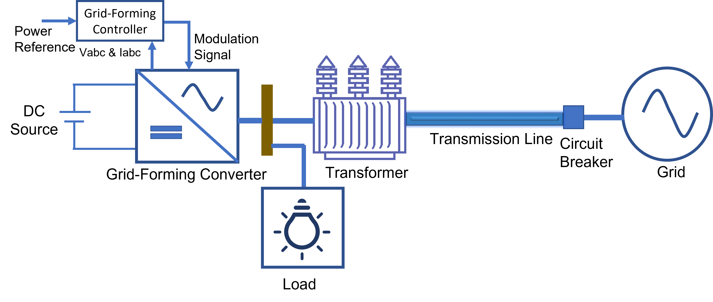</td>
    <td width="50%" align="center">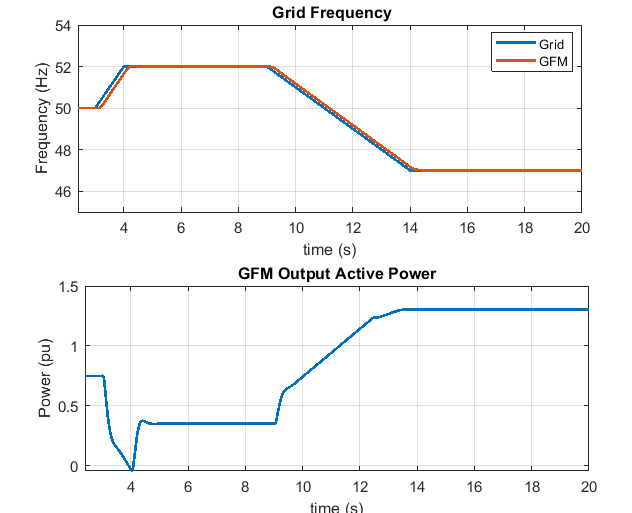</td>
  </tr>
</table>

## LLC Resonant Converter Design

This design solution enables you to design and analyze a full-bridge LLC resonant converter. The workflow guides you through developing the converter to meet your specifications by plotting gain curves for various load conditions, quality factors, and inductor ratios.

<table>
  <tr>
    <td width="50%" align="center">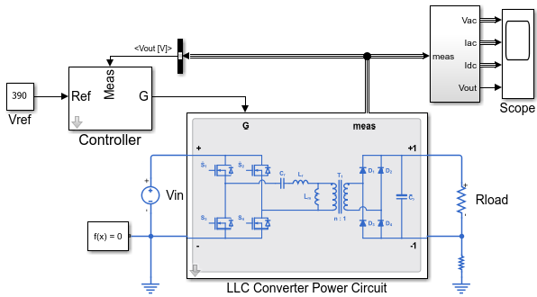</td>
    <td width="50%" align="center">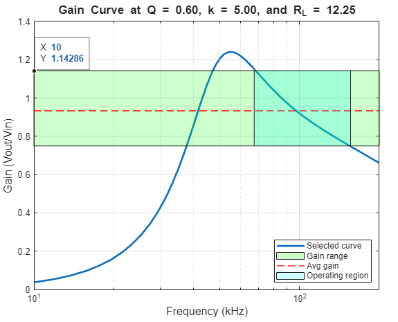</td>
  </tr>
</table>

## CLLC Bidirectional Resonant Converter Design

This design solution enables you to design and analyze a bidirectional CLLC resonant converter. A full-bridge synchronous rectifier on the secondary side allows power to flow in either direction.

<table>
  <tr>
    <td width="50%" align="center">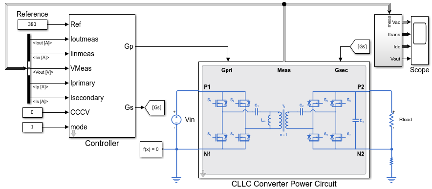</td>
    <td width="50%" align="center">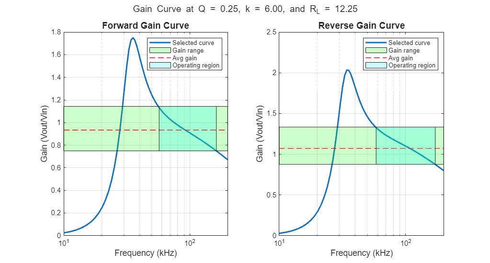</td>
  </tr>
</table>

## Dual-Active-Bridge Converter Design

This design solution enables you to design and analyze an isolated bidirectional dual-active-bridge (DAB) converter. The controller regulates either the output voltage or the output current.

<table>
  <tr>
    <td width="50%" align="center">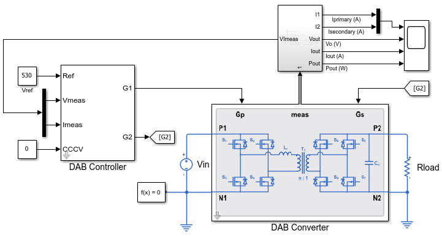</td>
    <td width="50%" align="center">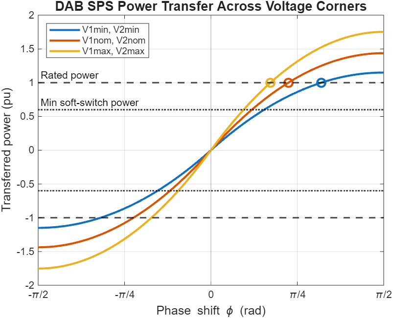</td>
  </tr>
</table>

## Dual-Active-Bridge Thermal Analysis with Custom MOSFET Model

This design solution simulates the junction temperature of the eight bridge devices of a dual active bridge converter that uses the MOSFET Model block from ConverterLibrary, and estimates the device loss and the efficiency.

<table>
  <tr>
    <td width="50%" align="center">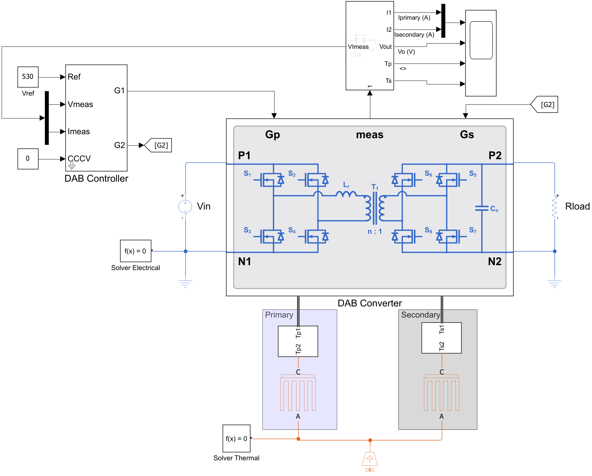</td>
    <td width="50%" align="center">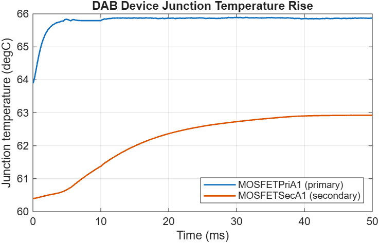</td>
  </tr>
</table>

## Totem-Pole Boost PFC Converter Design

This design solution enables you to design and analyze a totem-pole boost power factor correction (PFC) converter. You choose whether the slow leg is a diode, a MOSFET, or a thyristor.

<table>
  <tr>
    <td width="50%" align="center">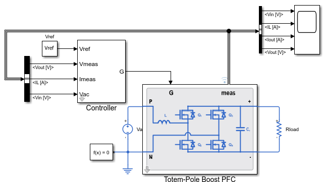</td>
    <td width="50%" align="center">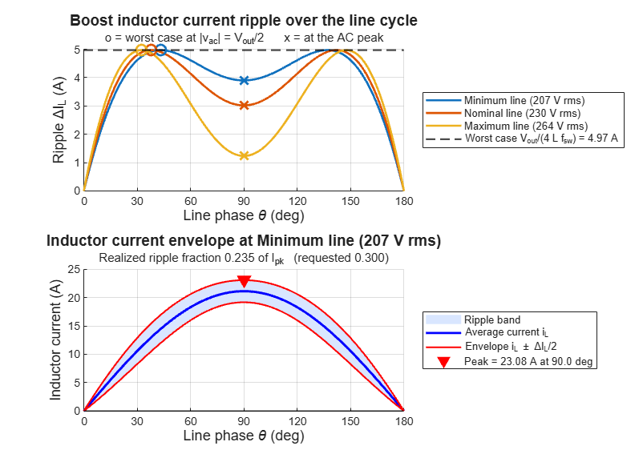</td>
  </tr>
</table>

## Boost PFC Converter Design

This design solution enables you to design and analyze a boost power factor correction (PFC) converter with a diode rectifier bridge at its input.

<table>
  <tr>
    <td width="50%" align="center">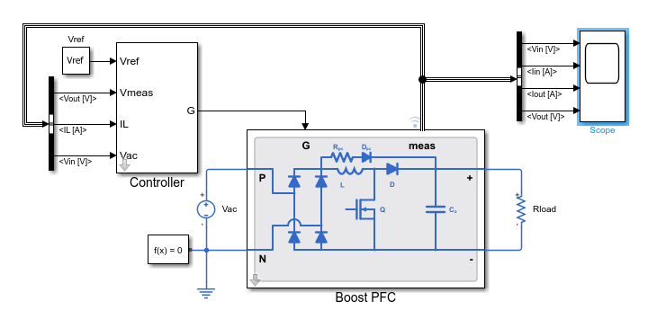</td>
    <td width="50%" align="center">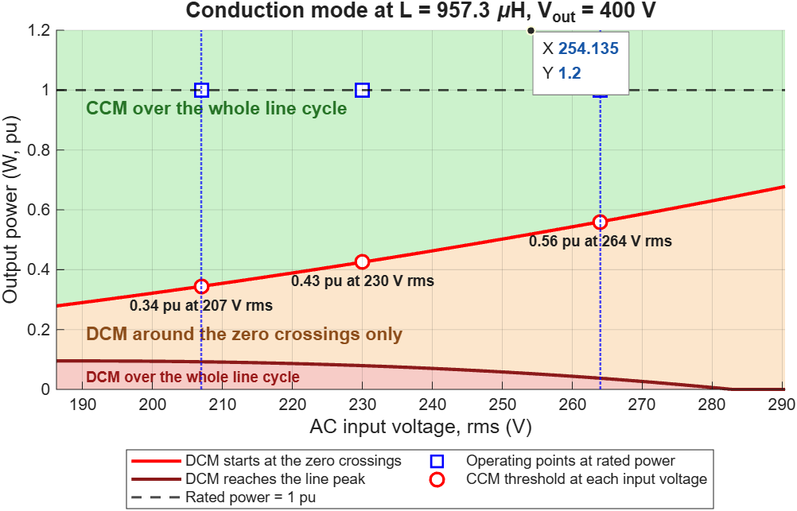</td>
  </tr>
</table>

## Interleaved Boost PFC Converter Design

This design solution enables you to design and analyze a two-leg interleaved boost power factor correction (PFC) converter. The two boost legs are identical and operate 180 degrees apart.

<table>
  <tr>
    <td width="50%" align="center">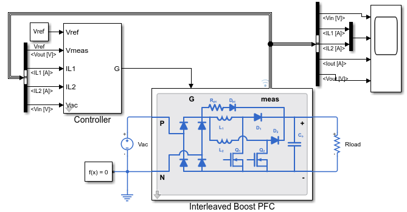</td>
    <td width="50%" align="center">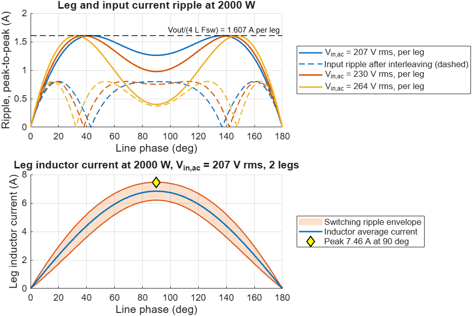</td>
  </tr>
</table>

## Non-Isolated DC-DC Converter Design

This design solution enables you to design and analyze a non-isolated DC-DC converter. Choose one of six topologies: buck, boost or buck-boost, each with a synchronous variant.

<table>
  <tr>
    <td width="50%" align="center">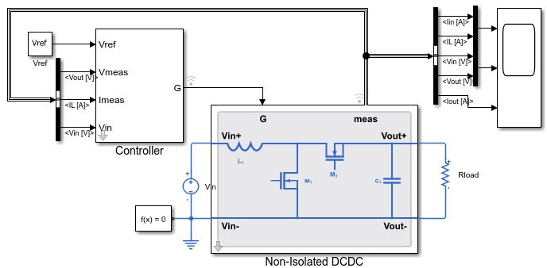</td>
    <td width="50%" align="center">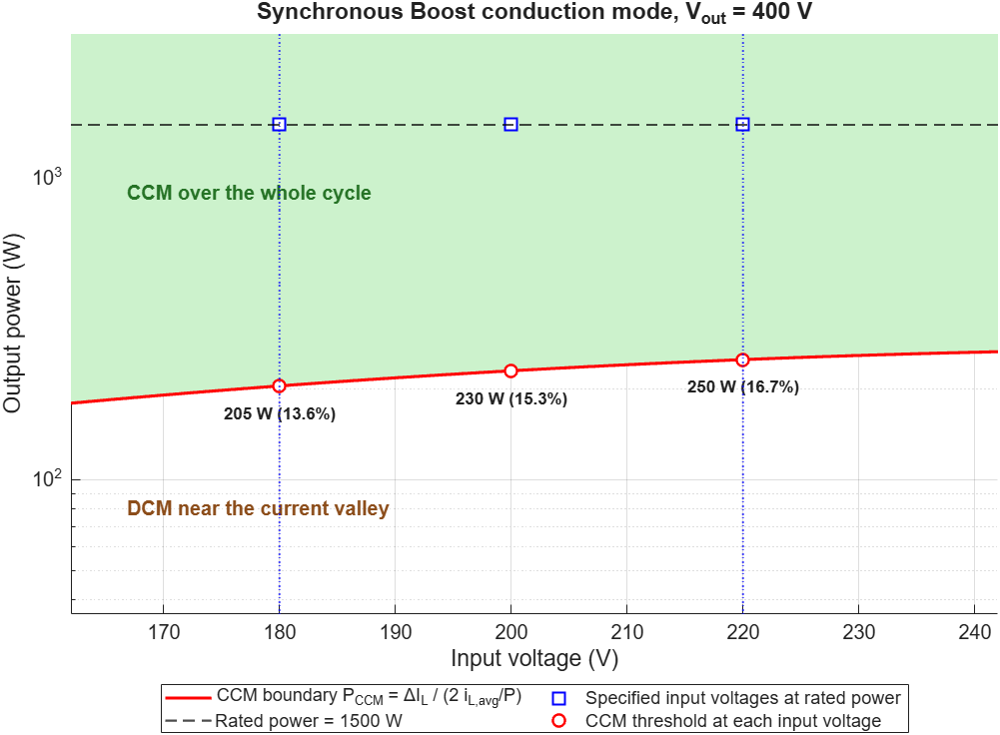</td>
  </tr>
</table>

---

## 🛠️ Prerequisites

- MATLAB R2026a or later
- Simscape and Simscape Electrical

---

## 🚀 Setup

1. Clone or download the repository.
2. Add the folder to your MATLAB path.
3. Open PowerConverterCircuitAndControlDesignWithSimscape.prj to get started.
4. Use project shortcut buttons in the toolstrip to access examples.
--------------------------------------------------------

© 2023–2026 The MathWorks, Inc.

